# MMA intramurals: database architecture and ERD

The live implementation uses PostgreSQL and Drizzle. `src/db/schema.ts` is the authoritative live definition, `postgresql.sql` is its SQL export, and `mma_intramurals.sql` is the independent MySQL/MariaDB InnoDB definition for an XAMPP port. Use one database engine per deployment. Their data files and password formats are not interchangeable.

```mermaid
erDiagram
    ROLES ||--o{ USERS : authorizes
    USERS ||--o{ AUTH_SESSIONS : authenticates
    USERS ||--o{ MEDIA_ASSETS : uploads
    USERS ||--o| STUDENTS : has-profile
    USERS ||--o| ADVISERS : has-profile
    INTRAMURALS ||--o{ EVENT_HOUSES : includes
    HOUSES ||--o{ EVENT_HOUSES : participates
    EVENT_HOUSES ||--o{ TEAM_MEMBERS : enrolls
    STUDENTS ||--o{ TEAM_MEMBERS : joins
    EVENT_HOUSES ||--o{ HOUSE_ADVISERS : supervised-by
    ADVISERS ||--o{ HOUSE_ADVISERS : supervises
    STUDENTS ||--o| RFID_CARDS : assigned
    STUDENTS ||--o| FACE_PROFILES : opts_in
    USERS ||--o{ RFID_CARDS : issues
    USERS o|--o{ FACE_PROFILES : approves
    INTRAMURALS ||--o{ RFID_STATIONS : operates
    USERS ||--o{ RFID_STATIONS : staffs
    RFID_STATIONS o|--o{ ATTENDANCE : tap_in
    RFID_STATIONS o|--o{ ATTENDANCE : tap_out
    INTRAMURALS ||--o{ FINALIZED_ATTENDANCE_DAYS : reviews
    USERS ||--o{ FINALIZED_ATTENDANCE_DAYS : finalizes
    FINALIZED_ATTENDANCE_DAYS ||--o{ ATTENDANCE_SANCTIONS : assesses
    ATTENDANCE ||--o| ATTENDANCE_SANCTIONS : relates_to
    USERS o|--o{ ATTENDANCE_SANCTIONS : revises
    INTRAMURALS ||--o{ ATTENDANCE_SESSIONS : opens
    USERS ||--o{ ATTENDANCE_SESSIONS : creates
    TEAM_MEMBERS ||--o{ ATTENDANCE : records
    ATTENDANCE_SESSIONS o|--o{ ATTENDANCE : time-in-source
    ATTENDANCE_SESSIONS o|--o{ ATTENDANCE : time-out-source
    INTRAMURALS ||--o{ EVENT_SPORTS : offers
    SPORTS ||--o{ EVENT_SPORTS : catalog-item
    EVENT_HOUSES ||--o{ SPORT_HOUSES : competes
    EVENT_SPORTS ||--o{ SPORT_HOUSES : enlists
    EVENT_SPORTS ||--o{ ATHLETE_SPORTS : registers
    TEAM_MEMBERS ||--o{ ATHLETE_SPORTS : plays
    EVENT_SPORTS ||--o{ TOURNAMENTS : organizes
    TOURNAMENTS o|--o{ MATCHES : generates
    SPORT_HOUSES ||--o{ MATCHES : home-side
    SPORT_HOUSES ||--o{ MATCHES : away-side
    VENUES ||--o{ MATCHES : hosts
    GAME_OFFICIALS o|--o{ MATCHES : officiates
    MATCHES ||--o| MATCH_SCORES : has-result
    USERS ||--o{ MATCH_SCORES : records
    INTRAMURALS ||--o{ POINT_SETTINGS : defines
    SPORT_HOUSES ||--o{ MEDAL_AWARDS : awarded
    INTRAMURALS ||--o{ ANNOUNCEMENTS : features
    USERS ||--o{ ANNOUNCEMENTS : authors
    INTRAMURALS ||--o{ GALLERY_PHOTOS : showcases
    INTRAMURALS o|--o{ AUDIT_LOGS : relates-to
    USERS ||--o{ AUDIT_LOGS : performs

    ROLES {
        varchar role_key PK
    }
    USERS {
        int id PK
        varchar role_key FK
        varchar username UK
        varchar password_hash
        boolean active
    }
    AUTH_SESSIONS {
        char token_hash PK
        int user_id FK
        datetime expires_at
    }
    MEDIA_ASSETS {
        varchar media_key PK
        enum scope
        text image_base64
        int created_by FK
    }
    LOGIN_LIMITS {
        char limit_key PK
        int attempts
        datetime expires_at
    }
    STUDENTS {
        int id PK
        int user_id FK, UK
        varchar student_number UK
        varchar last_name
        varchar course
        int year_level
    }
    ADVISERS {
        int id PK
        int user_id FK, UK
        varchar department
    }
    INTRAMURALS {
        int id PK
        varchar slug UK
        date start_date
        date end_date
        time cutoff_time
        enum state
        boolean published
    }
    HOUSES {
        int id PK
        varchar name UK
        char color
    }
    EVENT_HOUSES {
        int intramurals_id PK, FK
        int house_id PK, FK
    }
    TEAM_MEMBERS {
        int intramurals_id PK, FK
        int student_id PK, FK
        int house_id FK
        datetime assigned_at
    }
    HOUSE_ADVISERS {
        int intramurals_id PK, FK
        int house_id PK, FK
        int adviser_id PK, FK
    }
    RFID_CARDS {
        int student_id PK, FK
        char card_digest UK
        int issued_by FK
        datetime issued_at
    }
    FACE_PROFILES {
        int student_id PK, FK
        varchar encrypted_template
        datetime consented_at
        datetime expires_at
        varchar review_code
        int approved_by FK
    }
    RFID_STATIONS {
        int id PK
        int intramurals_id FK
        int operator_id FK
        varchar operator_session_hash
        date attendance_date
        datetime expires_at
    }
    FINALIZED_ATTENDANCE_DAYS {
        int intramurals_id PK, FK
        date attendance_date PK
        int finalized_by FK
        datetime finalized_at
    }
    ATTENDANCE_SANCTIONS {
        int id PK
        int intramurals_id FK
        int student_id FK
        date attendance_date FK
        int amount_centavos
        enum status
        int revised_by FK
    }
    ATTENDANCE_SESSIONS {
        int id PK
        int intramurals_id FK
        int created_by FK
        char token_hash UK
        char face_pin_hash
        enum session_type
        date attendance_date
        datetime expires_at
        boolean active
    }
    ATTENDANCE {
        int id PK
        int student_id FK
        int intramurals_id FK
        date attendance_date
        int in_session_id FK
        int out_session_id FK
        int in_station_id FK
        int out_station_id FK
        enum in_method
        enum out_method
        boolean sanction_eligible
        datetime time_in
        datetime time_out
        enum status
    }
    SPORTS {
        int id PK
        varchar name UK
        enum division
        enum kind
    }
    EVENT_SPORTS {
        int intramurals_id PK, FK
        int sport_id PK, FK
    }
    SPORT_HOUSES {
        int intramurals_id PK, FK
        int sport_id PK, FK
        int house_id PK, FK
    }
    ATHLETE_SPORTS {
        int intramurals_id PK, FK
        int sport_id PK, FK
        int student_id PK, FK
    }
    VENUES {
        int id PK
        varchar name UK
        boolean active
    }
    GAME_OFFICIALS {
        int id PK
        varchar name UK
        boolean active
    }
    TOURNAMENTS {
        int id PK
        int intramurals_id FK
        int sport_id FK
        enum format
    }
    MATCHES {
        int id PK
        int intramurals_id FK
        int sport_id FK
        int tournament_id FK
        int home_house_id FK
        int away_house_id FK
        int venue_id FK
        int official_id FK
        date match_date
        time start_time
        time end_time
        enum status
    }
    MATCH_SCORES {
        int match_id PK, FK
        int recorded_by FK
        int home_score
        int away_score
    }
    POINT_SETTINGS {
        int intramurals_id PK, FK
        int placement PK
        int points
    }
    MEDAL_AWARDS {
        int id PK
        int intramurals_id FK
        int sport_id FK
        int house_id FK
        varchar award_label
        int placement
    }
    ANNOUNCEMENTS {
        int id PK
        int intramurals_id FK
        int created_by FK
        enum audience
        datetime published_at
    }
    GALLERY_PHOTOS {
        int id PK
        int intramurals_id FK
        varchar file_url
        boolean published
    }
    AUDIT_LOGS {
        int id PK
        int actor_id FK
        int intramurals_id FK
        varchar entity_type
        varchar reason
        json snapshot
    }
    SYSTEM_SETTINGS {
        varchar settings_key PK
        varchar school_name
        varchar timezone
    }
```

## Constraints and derived data

- **History**: `(intramurals_id, student_id)` identifies one house assignment per season. House and sport participation are independent joins. Foreign keys validate that a roster, medal, or fixture refers to entities enrolled in the same event. An assignment with attendance or sports history cannot transfer inside that event. Disabled accounts remain linked to records. Completed events retain their assignments and fixtures.
- **Attendance**: `UNIQUE (student_id, intramurals_id, attendance_date)` enforces daily idempotency even across concurrent requests. A checkout updates only a row with a check-in and no checkout. Server time supplies the official attendance date and timestamps; the configured school time zone provides local time, and each event has its own late cutoff. Pending checkout and duration are derived, not stored. Unrecorded rows are distinguishable from explicitly marked or past-day absences. Attendance corrections are transactional and retain actor, reason, before/after data, and time.
- **RFID, face and sanctions**: The existing unique attendance row is shared by all capture methods. Card IDs and short-lived face PINs are stored as keyed digests; optional face profiles are encrypted and scoped to one student. Only explicit finalization of a past attendance day establishes its eligible roster. The unique sanction row links to both that day and the specific attendance row. [See the attendance add-on guide](../docs/attendance-access.md).
- **Sessions**: Attendance and browser session tokens are generated with 256 bits of randomness. Only SHA-256 digests are stored. Attendance sessions have individual expiry and active flags; at most one per event and direction is active at a time. The raw QR is shown only when it is generated.
- **Competition**: An advisory transaction lock serializes fixture writes and score transitions affecting bookings. Half-open intervals allow adjacent fixtures. Points are configured per placement and event. Medals derive from places 1–3; standings sort by configured points, then medal counts, with ties sharing rank. Match wins and draws derive from recorded scores and never award placement points implicitly.
- **Privacy**: Application reads filter membership predicates by the signed-in student’s or adviser’s assignment. Visitors receive only published competition and announcement data or clearly designated fictional examples. Student house rosters omit other students’ contact details and IDs. Audit events and QR data are not public.
- **Media**: Bounded JPEG, PNG, and WebP uploads are decoded and re-encoded without source metadata. Private student images require a current authorized account; public gallery images require both the asset and event to be published. Asset identifiers are linked from the applicable profile, school, house, or gallery record.
- **Indexes**: Student searches use the student identifier, name or course/year indexes; house/student joins use event composite indexes. Attendance uses event/date/status, QR sessions use expiry and token hash, fixtures use event/date/time, and audit uses event/time. Primary/unique keys back all identity and deduplication paths.
